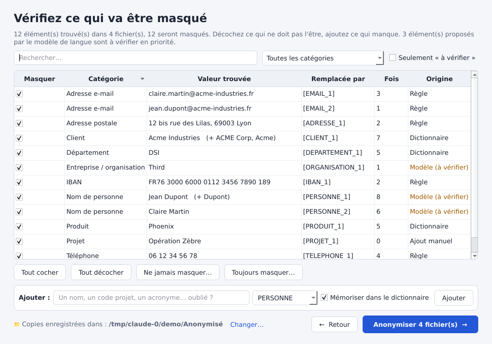
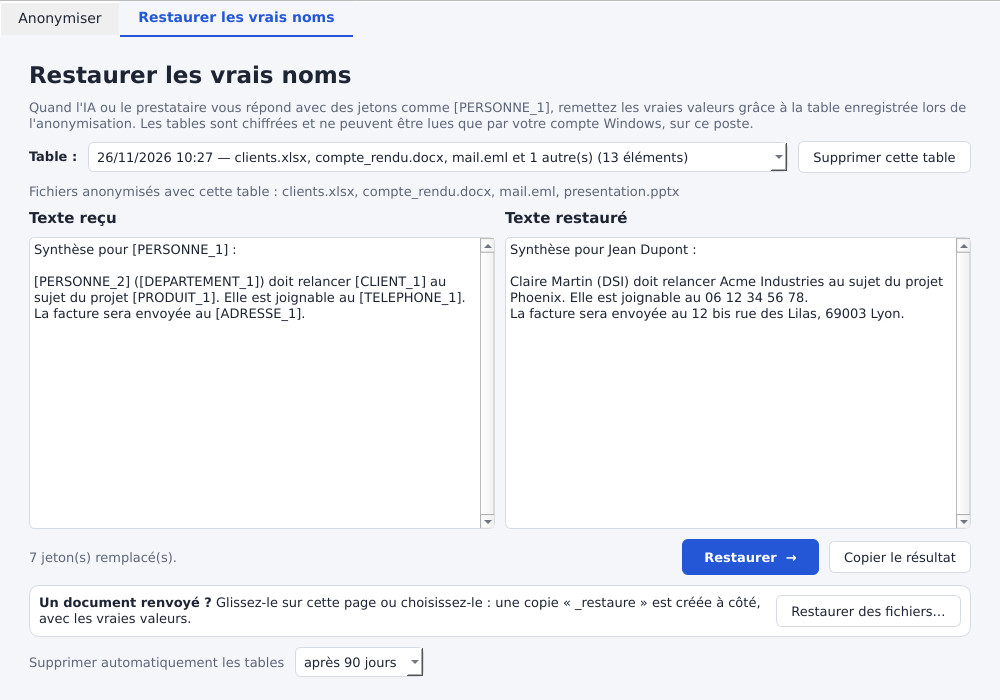

# NobodyDoc

Anonymise **en local** des documents Word, Excel, PowerPoint et des mails avant
de les envoyer à une IA ou à un prestataire. Aucune donnée ne quitte le poste.

> État : étapes 1 à 3 (moteur, interface graphique, restauration). L'exécutable
> Windows portable arrive à l'étape suivante.

## Interface

1. **Glissez vos fichiers** (ou un dossier entier) dans la fenêtre.
2. **Vérifiez** la liste de ce qui a été trouvé : décochez ce qui ne doit pas
   être masqué, ajoutez un terme oublié. Les propositions du modèle de langue
   sont signalées « à vérifier ». « Ne jamais masquer » et « Toujours
   masquer » enrichissent le dictionnaire pour les fois suivantes.
3. **Récupérez les copies** dans le dossier « Anonymisé », avec un rapport par
   fichier.

| Fichiers | Vérification | Résultat |
|---|---|---|
|  |  |  |

Le dictionnaire de l'entreprise s'édite depuis la fenêtre principale ; il est
enregistré dans `%APPDATA%\NobodyDoc\dictionnaire.csv` et peut être exporté
pour être partagé avec des collègues.

Lancement (en attendant l'exécutable) : `python -m nobodydoc.gui`

## Restaurer les vrais noms

Après chaque anonymisation, la correspondance jeton → valeur d'origine est
enregistrée dans `%APPDATA%\NobodyDoc\tables`, **chiffrée** (AES-256-GCM).
La clé est protégée par Windows (DPAPI) : seul votre compte Windows, sur ce
poste, peut relire les tables, sans mot de passe à retenir.

Dans l'onglet **Restaurer les vrais noms**, collez la réponse de l'IA ou du
prestataire (ou glissez le document renvoyé) : les jetons sont remplacés par
les vraies valeurs. Les jetons légèrement réécrits par une IA (`[Personne 1]`,
`PERSONNE_1`) sont reconnus. Un jeton absent de la table choisie est signalé.

Les tables sont supprimées automatiquement après 90 jours (réglable : 30
jours, 1 an, jamais) et peuvent être supprimées à la main.



## Ce qui est masqué

| Type | Exemple | Comment |
|---|---|---|
| Noms de personnes | Jean Dupont → `[PERSONNE_1]` | modèle de langue français local (spaCy) |
| Entreprises | Acme Industries → `[ORGANISATION_1]` | modèle de langue + dictionnaire |
| Termes de l'entreprise | clients, acronymes, départements, produits | dictionnaire (CSV ou JSON) |
| E-mails, téléphones (FR et international) | | règles |
| IBAN, cartes bancaires, n° de sécurité sociale | | règles avec clé de contrôle |
| SIREN / SIRET / TVA intracommunautaire | | règles |
| Adresses postales, codes postaux + villes | | règles |
| Sites web, adresses IP | | règles |

Une même valeur reçoit toujours le même jeton, dans tous les fichiers traités
ensemble. Un nom repéré une fois est masqué partout, y compris seul
(« Dupont », « M. Dupont ») ou dans une cellule Excel isolée.

## Formats

* **Word** (.docx) : texte, tableaux, en-têtes et pieds de page, notes,
  commentaires et leurs auteurs, révisions (y compris le texte supprimé),
  zones de texte, liens, graphiques.
* **Excel** (.xlsx) : cellules, commentaires et leurs auteurs, graphiques.
  Les nombres et formules sont conservés.
* **PowerPoint** (.pptx) : diapositives, notes du présentateur, graphiques
  (et leurs données Excel incorporées).
* **Mails** (.eml, .msg Outlook → .eml) : expéditeur et destinataires, objet,
  corps texte et HTML, pièces jointes Office. Les en-têtes techniques
  (serveurs, adresses IP) sont retirés, ainsi que les pièces jointes dans un
  format non pris en charge (PDF, images).
* **Texte** (.txt, .csv, .md, .json, .log).

Pour tous les formats Office : la mise en forme est conservée, l'auteur et la
société sont effacés des propriétés et la miniature d'aperçu est supprimée.
Les originaux ne sont jamais modifiés : une copie `nom_anonymise.ext` est créée.

**Limites connues** : le texte contenu dans les images n'est pas lu
(un avertissement est affiché) ; les noms d'onglets Excel sont signalés mais
pas renommés ; les anciens formats .doc/.xls/.ppt ne sont pas pris en charge.

## Dictionnaire de l'entreprise

Fichier CSV (modifiable dans Excel, séparateur `;`), voir
[`dictionnaire_exemple.csv`](dictionnaire_exemple.csv) :

```
terme;categorie;variantes
Acme;CLIENT;Acme Industries|ACME Corp
DSI;DEPARTEMENT;
Microsoft;EXCLUSION;
```

* La catégorie donne le nom du jeton (`[CLIENT_1]`, `[DEPARTEMENT_1]`...).
* Les variantes partagent le jeton du terme principal.
* Un terme en majuscules (acronyme) n'est cherché qu'en majuscules.
* La catégorie `EXCLUSION` liste les mots à ne jamais masquer.

## Ligne de commande

```
pip install -r requirements.txt
python -m nobodydoc rapport.docx clients.xlsx mail.msg --dictionnaire dico.csv --sortie anonymise --table
```

Options : `--sans-ner` (règles et dictionnaire seulement), `--lieux` (masque
aussi villes et pays), `--table` (affiche la correspondance jeton → valeur),
`--sans-sauvegarde` (n'enregistre pas la table chiffrée).

Restauration : `python -m nobodydoc reponse.docx --restaurer` (table la plus
récente) ou `--restaurer chemin\vers\table.ndtable`.

## Développement

```
pip install -r requirements-dev.txt
pytest
```

Les tests génèrent des documents d'exemple et vérifient qu'aucune valeur
sensible ne subsiste nulle part dans les fichiers produits (XML brut compris).
