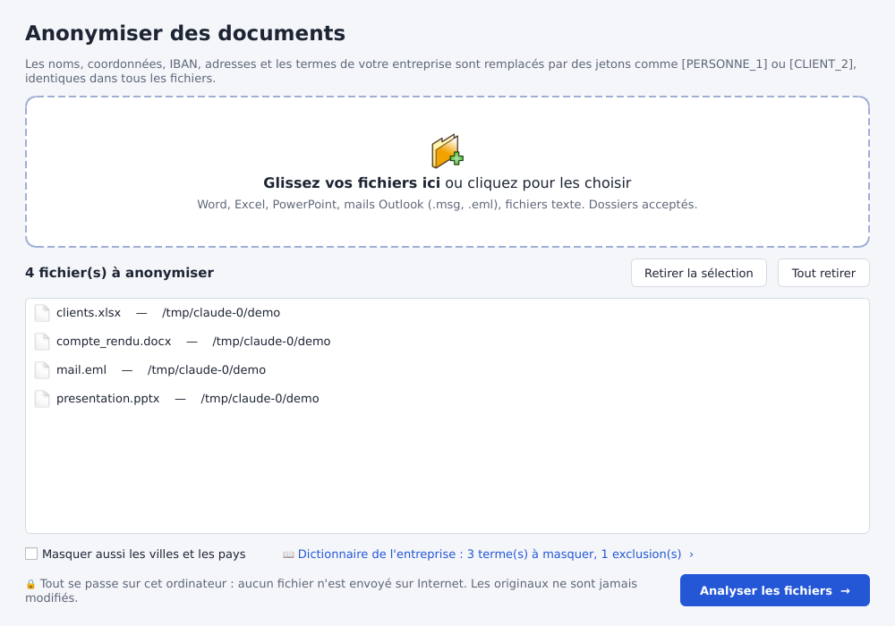
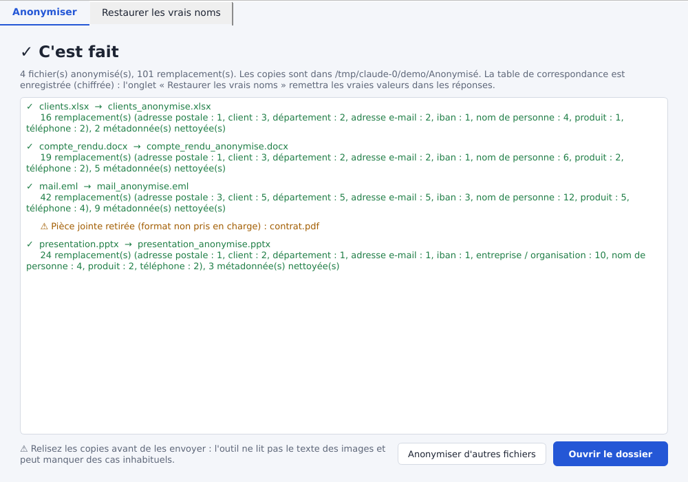

# NobodyDoc

Anonymise **en local** des documents Word, Excel, PowerPoint et des mails avant
de les envoyer à une IA ou à un prestataire. Aucune donnée ne quitte le poste.

## Télécharger (Windows, sans installation)

* **NobodyDoc.exe** : un seul fichier, à double-cliquer. Le premier
  démarrage prend quelques secondes (décompression).
* **NobodyDoc-portable.zip** : à décompresser où vous voulez (bureau, clé
  USB), puis lancez `NobodyDoc.exe` dans le dossier. Démarrage plus rapide.

Les deux sont fabriqués automatiquement par GitHub (onglet *Actions* →
*Exécutable Windows*, ou page *Releases* pour une version publiée). Aucun
droit administrateur n'est nécessaire. Le guide d'utilisation est dans l'onglet
**Aide** de l'application et dans [`docs/GUIDE.md`](docs/GUIDE.md).

> Windows SmartScreen peut afficher « Windows a protégé votre ordinateur » au
> premier lancement, car l'exécutable n'est pas signé : cliquez sur
> *Informations complémentaires* puis *Exécuter quand même*.

## Interface

1. **Glissez vos fichiers** (ou un dossier entier) dans la fenêtre.
2. **Vérifiez** la liste de ce qui a été trouvé : décochez ce qui ne doit pas
   être masqué, ajoutez un terme oublié. Les propositions du modèle de langue
   sont signalées « à vérifier ». « Ne jamais masquer » et « Toujours
   masquer » enrichissent le dictionnaire pour les fois suivantes.
3. **Récupérez les copies** dans le dossier « Anonymisé », avec un rapport par
   fichier.

| Fichiers | Vérification | Résultat |
|---|---|---|
|  |  |  |

Le dictionnaire de l'entreprise s'édite depuis la fenêtre principale ; il est
enregistré dans `%APPDATA%\NobodyDoc\dictionnaire.csv` et peut être exporté
pour être partagé avec des collègues.

Lancement (en attendant l'exécutable) : `python -m nobodydoc.gui`

## Restaurer les vrais noms

Après chaque anonymisation, la correspondance jeton → valeur d'origine est
enregistrée dans `%APPDATA%\NobodyDoc\tables`, **chiffrée** (AES-256-GCM).
La clé est protégée par Windows (DPAPI) : seul votre compte Windows, sur ce
poste, peut relire les tables, sans mot de passe à retenir.

Dans l'onglet **Restaurer les vrais noms**, collez la réponse de l'IA ou du
prestataire (ou glissez le document renvoyé) : les jetons sont remplacés par
les vraies valeurs. Les jetons légèrement réécrits par une IA (`[Personne 1]`,
`PERSONNE_1`) sont reconnus. Un jeton absent de la table choisie est signalé.

Les tables sont supprimées automatiquement après 90 jours (réglable : 30
jours, 1 an, jamais) et peuvent être supprimées à la main.


## Ce qui est masqué

| Type | Exemple | Comment |
|---|---|---|
| Noms de personnes | Jean Dupont → `[PERSONNE_1]` | modèle de langue français local (spaCy) |
| Entreprises | Acme Industries → `[ORGANISATION_1]` | modèle de langue + dictionnaire |
| Termes de l'entreprise | clients, acronymes, départements, produits | dictionnaire (CSV ou JSON) |
| E-mails, téléphones (FR et international) | | règles |
| IBAN, cartes bancaires, n° de sécurité sociale | | règles avec clé de contrôle |
| SIREN / SIRET / TVA intracommunautaire | | règles |
| Adresses postales, codes postaux + villes | | règles |
| Sites web, adresses IP (v4 et v6) | | règles |
| Noms de serveurs | `srv-paie01.acme.local` → `[HOTE_1]` | règles (domaines internes, chaînes de connexion) |
| Identifiants et mots de passe | `password=S3cret!` → `password=[SECRET_1]` | règles (chaînes de connexion, `password=`, `api_key:`...) |
| Clés et jetons d'accès | AWS, GitHub, GitLab, Slack, Stripe, Google, JWT, clés privées | règles |

Une même valeur reçoit toujours le même jeton, dans tous les fichiers traités
ensemble. Un nom repéré une fois est masqué partout, y compris seul
(« Dupont », « M. Dupont ») ou dans une cellule Excel isolée.

## Formats

* **Word** (.docx) : texte, tableaux, en-têtes et pieds de page, notes,
  commentaires et leurs auteurs, révisions (y compris le texte supprimé),
  zones de texte, liens, graphiques.
* **Excel** (.xlsx) : cellules, commentaires et leurs auteurs, graphiques.
  Les nombres et formules sont conservés.
* **PowerPoint** (.pptx) : diapositives, notes du présentateur, graphiques
  (et leurs données Excel incorporées).
* **Mails** (.eml, .msg Outlook → .eml) : expéditeur et destinataires, objet,
  corps texte et HTML, pièces jointes Office. Les en-têtes techniques
  (serveurs, adresses IP) sont retirés, ainsi que les pièces jointes dans un
  format non pris en charge (PDF, images).
* **Texte** (.txt, .csv, .md, .json, .log, .tsv).
* **Code et requêtes SQL** (.sql, .py, .js, .ts, .java, .cs, .php, .go, .sh,
  .ps1, .bat...) et **configuration** (.yaml, .toml, .ini, .env, .properties,
  .xml, .config) : seules les valeurs sensibles changent, le code reste
  valide (`email = '[EMAIL_1]'`) et l'encodage, les fins de ligne et
  l'indentation sont conservés. Dans une chaîne de connexion, seuls
  l'utilisateur, le mot de passe et le serveur sont masqués
  (`postgresql://[IDENTIFIANT_1]:[SECRET_1]@[HOTE_1]:5432/crm`). Le modèle de
  langue ne lit que les commentaires et les chaînes de caractères, pour ne pas
  prendre un nom de variable pour un nom de personne. Un nom de serveur court
  sans domaine (`srv-paie01` seul) n'est reconnu que dans une chaîne de
  connexion ou après `host=` / `server=` : ajoutez les autres au dictionnaire.

Pour tous les formats Office : la mise en forme est conservée, l'auteur et la
société sont effacés des propriétés et la miniature d'aperçu est supprimée.
Les originaux ne sont jamais modifiés : une copie `nom_anonymise.ext` est créée.

**Limites connues** : le texte contenu dans les images n'est pas lu
(un avertissement est affiché) ; les noms d'onglets Excel sont signalés mais
pas renommés ; les anciens formats .doc/.xls/.ppt ne sont pas pris en charge.

## Dictionnaire de l'entreprise

Fichier CSV (modifiable dans Excel, séparateur `;`), voir
[`dictionnaire_exemple.csv`](dictionnaire_exemple.csv) :

```
terme;categorie;variantes
Acme;CLIENT;Acme Industries|ACME Corp
DSI;DEPARTEMENT;
Microsoft;EXCLUSION;
```

* La catégorie donne le nom du jeton (`[CLIENT_1]`, `[DEPARTEMENT_1]`...).
* Les variantes partagent le jeton du terme principal.
* Un terme en majuscules (acronyme) n'est cherché qu'en majuscules.
* La catégorie `EXCLUSION` liste les mots à ne jamais masquer.

## Ligne de commande

```
pip install -r requirements.txt
python -m nobodydoc rapport.docx clients.xlsx mail.msg --dictionnaire dico.csv --sortie anonymise --table
```

Options : `--sans-ner` (règles et dictionnaire seulement), `--lieux` (masque
aussi villes et pays), `--table` (affiche la correspondance jeton → valeur),
`--sans-sauvegarde` (n'enregistre pas la table chiffrée).

Restauration : `python -m nobodydoc reponse.docx --restaurer` (table la plus
récente) ou `--restaurer chemin\vers\table.ndtable`.

## Développement

Fabriquer l'exécutable à la main (sous Windows) :

```
pip install -r requirements.txt pyinstaller
pyinstaller packaging/nobodydoc.spec                 # dossier dist/NobodyDoc
set NOBODYDOC_ONEFILE=1 && pyinstaller packaging/nobodydoc.spec   # fichier unique
dist\NobodyDoc\NobodyDoc.exe --auto-test resultat.txt   # vérification
```

```
pip install -r requirements-dev.txt
pytest
```

Les tests génèrent des documents d'exemple et vérifient qu'aucune valeur
sensible ne subsiste nulle part dans les fichiers produits (XML brut compris).
